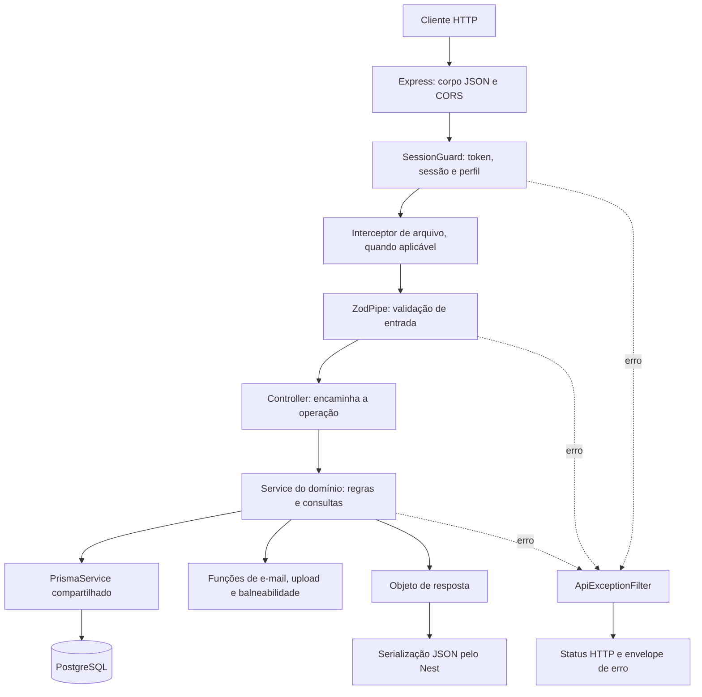

# Caragua360 — explicação do código

[Configuração e execução](../README.md) · [Requisições e payloads](README-API.md)

Este guia descreve a implementação que está neste projeto. Use-o para localizar uma funcionalidade, entender o caminho dos dados e saber onde fazer alterações. O backend migrou o comportamento do projeto Express para módulos/controllers/services NestJS, preservando várias funções compartilhadas e schemas Zod.

## 1. Visão geral da arquitetura



Arquivos estáticos `/uploads` e as rotas de saúde têm tratamento próprio; não executam necessariamente todo esse percurso. O diagrama representa as rotas de negócio.

Há três arquivos centrais em cada domínio:

| Arquivo | Responsabilidade |
| --- | --- |
| `*.module.ts` | Registra o controller e o service no container de dependências do Nest. |
| `*.controller.ts` | Define método/caminho HTTP, status, acesso, pipe e interceptor; chama o service. |
| `*.service.ts` | Implementa as operações de negócio, verifica propriedade/estado, consulta o banco e monta respostas. |

Não há uma camada de repositories ou DTOs em classes decoradas. Os services consultam Prisma diretamente; o contrato de entrada é definido nos schemas Zod. Há tipos `any` em várias fronteiras e helpers, herdados da portabilidade do código original. TypeScript compilar não significa que todos os dados estejam tipados de ponta a ponta.

## 2. Arquivos da raiz

| Arquivo/pasta | O que faz |
| --- | --- |
| `package.json` | Dependências e scripts. Define NestJS 11, Prisma 6.19, TypeScript, Zod, jose, bcrypt, Multer e Nodemailer. |
| `package-lock.json` | Registra as versões resolvidas; `npm ci` usa esse arquivo para reproduzir a instalação. |
| `tsconfig.json` | Compila `src/**/*.ts` para CommonJS/ES2023 em `dist`, com metadados de decorators. Ativa `strictNullChecks`, mas permite parâmetros implicitamente `any`. |
| `nest-cli.json` | Configura `src` como raiz para o CLI e limpeza da saída durante compilação pelo Nest. |
| `.env.example` | Modelo das variáveis. Não contém as credenciais reais do ambiente. |
| `.env` | Configuração local, se você a criar. Não deve ir para o controle de versão. |
| `.gitignore` | Ignora `node_modules`, `dist`, `.env` e `uploads`. |
| `routes.json` | Inventário das 77 rotas migradas. Não registra rotas no Nest; serve de referência e é usado no teste de cobertura de registro. |
| `src` | Fontes TypeScript da aplicação. |
| `database` | Schema Prisma, migration SQL e seed. |
| `test` | Testes HTTP em CommonJS que importam o código compilado. |
| `docs` | Guias da API e do código. |
| `dist` | JavaScript gerado, mapas de fonte e saída de compilação. Não edite manualmente. |
| `node_modules` | Dependências instaladas. Não edite manualmente. |
| `uploads` | Pasta criada sob demanda para arquivos enviados, salvo configuração diferente. |

## 3. Inicialização — `src/main.ts`

O arquivo carrega `dotenv/config` antes dos módulos da aplicação. Isso disponibiliza o `.env` às configurações importadas depois. `reflect-metadata` permite ao Nest consultar os metadados usados pelos decorators e pela injeção de dependências.

`createApp()` é exportada para reutilização nos testes. Ela:

1. Impede execução em produção sem `CARAGUA_JWT_SECRET` com pelo menos 32 caracteres.
2. Cria uma `NestExpressApplication` a partir de `AppModule`, usando o adaptador Express.
3. Configura confiança em um proxy e remove `X-Powered-By`.
4. Instala parsers JSON e URL encoded com limite de 2 MB.
5. Define o prefixo global `/api` e o filtro global de erros.
6. Expõe a pasta local de uploads em `/uploads/`, com cache de sete dias.
7. Habilita CORS com uma origem específica e credenciais, se `PUBLIC_SITE_URL` estiver definido.
8. Ativa hooks de desligamento e inicializa a aplicação.

O bloco `require.main === module` abre a porta somente quando o arquivo é executado diretamente. Os testes podem chamar `createApp()` sem iniciar uma porta fixa. A inicialização chama `listen(env.port, '0.0.0.0')` e registra falhas no console.

**Onde alterar:** tamanho máximo de JSON, CORS, origem pública, prefixo, exposição de arquivos e opções do servidor. O limite de 2 MB do corpo JSON é diferente do limite de 5 MB do upload multipart.

## 4. Composição — `src/app.module.ts`

`AppModule` importa o módulo de banco e os 16 módulos de negócio. Também registra `HealthController`.

Um módulo só participa da aplicação quando é importado por outro módulo que alcance a raiz. Criar os arquivos de uma nova funcionalidade sem registrar/importar seu módulo não disponibiliza seus endpoints.

## 5. Configuração e banco

### `src/config/environment.ts`

Centraliza o objeto `env`. Lê `process.env` no momento da importação e define padrões. Organiza configurações de execução, banco, JWT, sessão, bloqueio de login, recuperação de senha, arquivos, SMTP e balneabilidade.

`normalizeDatabaseUrl()` converte o parâmetro PostgreSQL `ssl=true`/`ssl=1` em `sslmode=require`. `uploadDir` é resolvido para caminho absoluto; quando relativo, usa o diretório atual do processo.

O projeto usa um objeto exportado, sem `ConfigModule`/`ConfigService` do Nest. Alterar `.env` exige reiniciar o processo. A validação das variáveis é parcial: a chave de produção é verificada na inicialização, mas não há schema global validando todas as portas, URLs e valores numéricos.

### `src/config/database.ts`

`PrismaService` estende `PrismaClient`. Seu construtor aplica `env.databaseUrl`. O hook `onModuleDestroy()` fecha conexões com `$disconnect()`.

O arquivo cria uma instância `prisma` e a registra no `DatabaseModule` com `useValue`. O módulo é global e exporta `PrismaService`; por isso os services de negócio podem receber o banco pelo construtor sem importar o módulo individualmente.

```typescript
constructor(private readonly prisma: PrismaService) {}
```

Esse código declara uma dependência e uma propriedade privada de leitura. O Nest injeta a instância registrada. `this.prisma.local.findMany(...)`, por exemplo, consulta a tabela/modelo `Local`.

As funções compartilhadas ainda importam `prisma` diretamente em alguns pontos. Elas usam a mesma instância registrada no Nest, mas essa dependência direta é diferente da injeção por construtor e precisa ser considerada ao substituir o banco nos testes.

`checkDatabase()` executa `SELECT 1`, retornando um booleano. O cliente conecta sob demanda; iniciar o processo não comprova a disponibilidade do banco.

## 6. Infraestrutura HTTP — `src/common`

### `api-request.ts`

`ApiRequest` estende o `Request` do Express com parâmetros de caminho em texto, `user`, `sessionId` e `validatedQuery`. Descreve os campos acrescentados pelo guard e pelo controller. É uma interface TypeScript; não valida dados em tempo de execução.

O operador `req.user!` nos services é uma afirmação ao compilador de que o usuário existe. Ele depende do guard estar corretamente configurado naquela rota; não realiza uma checagem em runtime.

### `http.ts`: decorator `Access`

`Access(required, roles)` grava metadados na rota usando `SetMetadata`:

```typescript
@Access(false, [])           // público, mas pode reconhecer uma sessão
@Access(true, [])            // precisa de login
@Access(true, ['ADMIN'])     // precisa de login e perfil ADMIN
```

O decorator só armazena a política. É o `SessionGuard` aplicado por `@UseGuards` que a executa.

### `http.ts`: `SessionGuard`

Lê a política com `Reflector` e procura token no Bearer ou no cookie `caragua_session`, nessa ordem. Valida assinatura HS256, emissor e expiração com `jose`. O payload precisa conter `sid` textual.

Depois busca a sessão e o usuário no banco. Aceita somente sessão não revogada e não expirada, cujo usuário esteja ativo e não excluído. Preenche `req.user` com os dados públicos e `req.sessionId` com o ID da sessão. O perfil usado na autorização vem do usuário consultado, não apenas do claim do JWT.

Em falhas de verificação, mantém comportamento anônimo. A rota protegida então gera 401, e o perfil insuficiente gera 403. Como esse bloco também envolve a consulta de sessão, uma falha nela pode se apresentar como ausência de autenticação; use `/api/health/db` para diagnosticar o banco separadamente.

### `http.ts`: `ZodPipe`

Recebe um schema Zod e executa `safeParse`. No sucesso, retorna os dados validados/transformados; na falha, lança `AppError` 422 com uma lista de `{ path, message }`.

O controller recebe o resultado por `@Body(new ZodPipe(schema))` ou `@Query(...)` e o coloca em `req.body`/`req.validatedQuery`, preservando a interface consumida pelos services. Portanto, defaults e transformações do schema entram nos dados que chegam ao service.

O pipe só roda onde foi aplicado. Importar um schema em um arquivo não ativa sua validação automaticamente.

### `http.ts`: `imageOptions`

Configura armazenamento em memória do Multer, um arquivo e limite de 5 MB. O filtro aceita MIME JPEG, PNG, WEBP ou GIF. O controller aplica `FileInterceptor('photo', imageOptions)`; o arquivo fica em `req.file`.

A gravação no disco acontece depois, em `storeImage()`. `memoryStorage()` não significa que o arquivo final permanece apenas em memória. O filtro MIME não substitui uma inspeção de assinatura binária do arquivo.

### `http.ts`: `ApiExceptionFilter`

Captura exceções. Exceções HTTP do Nest têm status preservado e envelope JSON com `NOT_FOUND` ou `HTTP_ERROR`. Outras passam para o mapeador compartilhado `errorHandler`.

Essa divisão explica por que erros de upload convertidos pelo interceptor podem ter código diferente dos erros Multer tratados diretamente pelo mapeador.

### `health.controller.ts`

- `health()`: retorna status do processo, sem acessar o banco.
- `database()`: chama `checkDatabase()`, escolhe HTTP 200/503 e retorna o resultado.

## 7. Como ler um controller

Exemplo simplificado, correspondente ao padrão usado:

```typescript
@Post('locals')
@HttpCode(201)
@Access(true, ['ADMIN'])
@UseGuards(SessionGuard)
createLocal(
  @Req() req: ApiRequest,
  @Body(new ZodPipe(localSchema)) validated: any,
) {
  req.body = validated;
  return this.service.createLocal(req);
}
```

`@Post` define verbo/caminho; o prefixo `/api` vem do bootstrap. `@HttpCode` define sucesso. `@Access` e o guard protegem a rota. `@Body` aplica o pipe. O controller encaminha ao service e devolve o objeto, que o Nest serializa.

Nos domínios de autenticação e usuário, alguns métodos recebem `@Res({ passthrough: true })`. Isso permite definir/apagar cookies e ainda deixar o Nest enviar o JSON retornado. Os services ainda recebem o objeto `Request`; o código não separa completamente transporte HTTP e regras de negócio.

Os controllers usam caminhos completos de negócio com `@Controller()` sem prefixo específico. Por isso um mesmo controller pode registrar rotas normais e administrativas: `UserController`, por exemplo, também registra `/admin/users`.

## 8. Módulos de negócio

Cada seção aponta os três arquivos do domínio e explica as regras principais. A tabela de métodos mostra a ligação exata entre o handler e o endpoint. Regras completas de entrada e exemplos estão no guia da API.

### `accommodation` — Hospedagens

Lista hospedagens ativas com foto e resumo; detalhe aceita ID/slug e inclui fotos/favorito. `data()` transforma campos opcionais e amenidades. Criação gera slug e fotos; atualização usa transação; exclusão inativa o registro. Categoria é Hotel ou Pousada. Não é um sistema de reservas ou pagamentos.

- [`accommodation.module.ts`](../src/modules/accommodation/accommodation.module.ts)
- [`accommodation.controller.ts`](../src/modules/accommodation/accommodation.controller.ts)
- [`accommodation.service.ts`](../src/modules/accommodation/accommodation.service.ts)

| Método do service | Endpoint que o utiliza |
| --- | --- |
| `listAccommodations` | `GET /api/accommodations` |
| `getAccommodation` | `GET /api/accommodations/:id` |
| `createAccommodation` | `POST /api/accommodations` |
| `updateAccommodation` | `PUT /api/accommodations/:id` |
| `deleteAccommodation` | `DELETE /api/accommodations/:id` |

### `activity` — Atividades

Consulta catálogo ativo de atividades. `data()` prepara local, contato, horários textuais e informações de preço. Escrita administrativa gera slug e associa fotos. Exclusão inativa. O campo de horário é informativo, sem execução de tarefas agendadas.

- [`activity.module.ts`](../src/modules/activity/activity.module.ts)
- [`activity.controller.ts`](../src/modules/activity/activity.controller.ts)
- [`activity.service.ts`](../src/modules/activity/activity.service.ts)

| Método do service | Endpoint que o utiliza |
| --- | --- |
| `listActivities` | `GET /api/activities` |
| `getActivity` | `GET /api/activities/:id` |
| `createActivity` | `POST /api/activities` |
| `updateActivity` | `PUT /api/activities/:id` |
| `deleteActivity` | `DELETE /api/activities/:id` |

### `admin` — Administração e moderação

Conta usuários, destinos, roteiros, pendências, eventos, avaliações e favoritos por consultas paralelas. Lista roteiros e pendentes. Aprovação/rejeição exige PENDING e grava responsável/data; aprovação publica e rejeição armazena reason. Também expõe consulta e sincronização administrativa de balneabilidade. Usuários, sugestões e sustentabilidade administrativos ficam nos controllers dos respectivos domínios.

- [`admin.module.ts`](../src/modules/admin/admin.module.ts)
- [`admin.controller.ts`](../src/modules/admin/admin.controller.ts)
- [`admin.service.ts`](../src/modules/admin/admin.service.ts)

| Método do service | Endpoint que o utiliza |
| --- | --- |
| `statsHandler` | `GET /api/admin/stats` |
| `pendingItineraries` | `GET /api/admin/itineraries/pending` |
| `allItineraries` | `GET /api/admin/itineraries` |
| `approveItinerary` | `PATCH /api/admin/itineraries/:id/approve` |
| `rejectItinerary` | `PATCH /api/admin/itineraries/:id/reject` |
| `balneabilityAdmin` | `GET /api/admin/balneabilidade` |
| `balneabilityRefresh` | `POST /api/admin/balneabilidade/sync` |

### `auth` — Autenticação

Encaminha cadastro, login, logout e senhas às funções compartilhadas de autenticação. Cadastro/login definem cookie e retornam `{ user, token }`. `meHandler` devolve o usuário reconhecido pelo guard ou null. `origin()` escolhe a origem dos links de recuperação: cabeçalho Origin aceito, URL configurada e, por último, protocolo/host da requisição.

- [`auth.module.ts`](../src/modules/auth/auth.module.ts)
- [`auth.controller.ts`](../src/modules/auth/auth.controller.ts)
- [`auth.service.ts`](../src/modules/auth/auth.service.ts)

| Método do service | Endpoint que o utiliza |
| --- | --- |
| `registerHandler` | `POST /api/auth/register` |
| `loginHandler` | `POST /api/auth/login` |
| `logoutHandler` | `POST /api/auth/logout` |
| `meHandler` | `GET /api/auth/me` |
| `forgotPasswordHandler` | `POST /api/auth/forgot-password` |
| `resetPasswordHandler` | `POST /api/auth/reset-password` |
| `changePasswordHandler` | `POST /api/auth/change-password` |

### `balneability` — Consulta pública de balneabilidade

Encaminha a consulta para getBalneabilityOverview. Não dispara sincronização ao consultar; a gravação é acionada pela rota administrativa. Pode haver registros armazenados mesmo quando available é falso por causa do estado em memória da integração.

- [`balneability.module.ts`](../src/modules/balneability/balneability.module.ts)
- [`balneability.controller.ts`](../src/modules/balneability/balneability.controller.ts)
- [`balneability.service.ts`](../src/modules/balneability/balneability.service.ts)

| Método do service | Endpoint que o utiliza |
| --- | --- |
| `balneabilityHandler` | `GET /api/balneabilidade` |

### `event` — Eventos

Lista eventos ativos em ordem de início. `data()` converte datas por `toDate()` e rejeita início inválido. Detalhes aceitam ID/slug. Escrita administrativa mantém fotos e campos informativos. A exclusão inativa o registro; não é cadastro de ingressos ou inscrições.

- [`event.module.ts`](../src/modules/event/event.module.ts)
- [`event.controller.ts`](../src/modules/event/event.controller.ts)
- [`event.service.ts`](../src/modules/event/event.service.ts)

| Método do service | Endpoint que o utiliza |
| --- | --- |
| `listEvents` | `GET /api/events` |
| `getEvent` | `GET /api/events/:id` |
| `createEvent` | `POST /api/events` |
| `updateEvent` | `PUT /api/events/:id` |
| `deleteEvent` | `DELETE /api/events/:id` |

### `favorite` — Favoritos

Lista vínculos do usuário com dados do conteúdo. A criação confere exatamente um alvo via schema, existência do registro e duplicação; para roteiro exige APPROVED. Remoção é exclusiva do dono e usa o ID do favorito. Não há alvo para atividade ou evento no schema de favoritos.

- [`favorite.module.ts`](../src/modules/favorite/favorite.module.ts)
- [`favorite.controller.ts`](../src/modules/favorite/favorite.controller.ts)
- [`favorite.service.ts`](../src/modules/favorite/favorite.service.ts)

| Método do service | Endpoint que o utiliza |
| --- | --- |
| `listFavorites` | `GET /api/favorites` |
| `addFavorite` | `POST /api/favorites` |
| `removeFavorite` | `DELETE /api/favorites/:id` |

### `itinerary` — Roteiros

Agrupa roteiro, dias, lugares, fotos, avaliações e curtidas. `itineraryInclude` centraliza relações consultadas. `serialize()` calcula capa, médias, contagens e curtida do visitante. `persistDays()` grava dias/lugares/fotos dentro da transação recebida. Criação usa DRAFT; listagem pública exige APPROVED e publicação. Propriedade e estado são conferidos antes de editar, excluir e submeter. Edição substitui a composição enviada e faz um aprovado voltar a DRAFT. Curtida alterna criação/exclusão do vínculo.

- [`itinerary.module.ts`](../src/modules/itinerary/itinerary.module.ts)
- [`itinerary.controller.ts`](../src/modules/itinerary/itinerary.controller.ts)
- [`itinerary.service.ts`](../src/modules/itinerary/itinerary.service.ts)

| Método do service | Endpoint que o utiliza |
| --- | --- |
| `listPublicItineraries` | `GET /api/itineraries` |
| `listMyItineraries` | `GET /api/itineraries/mine` |
| `createItinerary` | `POST /api/itineraries` |
| `getItinerary` | `GET /api/itineraries/:id` |
| `updateItinerary` | `PUT /api/itineraries/:id` |
| `deleteItinerary` | `DELETE /api/itineraries/:id` |
| `submitItinerary` | `POST /api/itineraries/:id/submit` |
| `toggleLike` | `POST /api/itineraries/:id/like` |

### `local` — Destinos

Lista destinos ativos, aplica filtros, monta cartões com resumo, foto e média de avaliações. `randomLocal` sorteia um deslocamento entre destinos ativos. Detalhe aceita ID/slug e inclui avaliações, comentários, favorito e último registro de balneabilidade. `card()` formata o resumo e `localData()` prepara campos/fotos. Criação gera slug disponível; atualização usa transação para dados e fotos; exclusão inativa sem apagar histórico.

- [`local.module.ts`](../src/modules/local/local.module.ts)
- [`local.controller.ts`](../src/modules/local/local.controller.ts)
- [`local.service.ts`](../src/modules/local/local.service.ts)

| Método do service | Endpoint que o utiliza |
| --- | --- |
| `listLocals` | `GET /api/locals` |
| `randomLocal` | `GET /api/locals/random` |
| `getLocal` | `GET /api/locals/:id` |
| `createLocal` | `POST /api/locals` |
| `updateLocal` | `PUT /api/locals/:id` |
| `deleteLocal` | `DELETE /api/locals/:id` |

### `restaurant` — Restaurantes

Lista restaurantes ativos e detalhes com fotos/favorito. `data()` prepara contato, culinária, faixa de preço e horários como JSON. Operações de escrita exigem ADMIN; criação gera slug, atualização gerencia fotos e exclusão inativa. Não recebe pedidos nem faz reservas.

- [`restaurant.module.ts`](../src/modules/restaurant/restaurant.module.ts)
- [`restaurant.controller.ts`](../src/modules/restaurant/restaurant.controller.ts)
- [`restaurant.service.ts`](../src/modules/restaurant/restaurant.service.ts)

| Método do service | Endpoint que o utiliza |
| --- | --- |
| `listRestaurants` | `GET /api/restaurants` |
| `getRestaurant` | `GET /api/restaurants/:id` |
| `createRestaurant` | `POST /api/restaurants` |
| `updateRestaurant` | `PUT /api/restaurants/:id` |
| `deleteRestaurant` | `DELETE /api/restaurants/:id` |

### `review` — Avaliações e comentários

Lista por destino ou roteiro; ausência de alvo retorna erro. `assertTarget()` confere o alvo e exige destino ativo quando aplicável. Avaliação tem nota inteira de 1 a 5 e é única por usuário/alvo no fluxo do service. Comentário é texto e permite múltiplas entradas. Edição/exclusão verificam proprietário ou ADMIN. O service de comentários não oferece atualização; o frontend deve usar apenas as rotas existentes.

- [`review.module.ts`](../src/modules/review/review.module.ts)
- [`review.controller.ts`](../src/modules/review/review.controller.ts)
- [`review.service.ts`](../src/modules/review/review.service.ts)

| Método do service | Endpoint que o utiliza |
| --- | --- |
| `listReviews` | `GET /api/reviews` |
| `createReview` | `POST /api/reviews` |
| `updateReview` | `PUT /api/reviews/:id` |
| `deleteReview` | `DELETE /api/reviews/:id` |
| `listComments` | `GET /api/comments` |
| `createComment` | `POST /api/comments` |
| `deleteComment` | `DELETE /api/comments/:id` |

### `suggestion` — Sugestões de moradores

Criação exige RESIDENT/ADMIN e começa como PENDING. Usuário consulta suas próprias sugestões; ADMIN consulta todas e modera apenas pendentes. A ação approve aprova; reject rejeita e pode guardar note em adminNote. Aprovar não cria/atualiza automaticamente o conteúdo sugerido.

- [`suggestion.module.ts`](../src/modules/suggestion/suggestion.module.ts)
- [`suggestion.controller.ts`](../src/modules/suggestion/suggestion.controller.ts)
- [`suggestion.service.ts`](../src/modules/suggestion/suggestion.service.ts)

| Método do service | Endpoint que o utiliza |
| --- | --- |
| `createSuggestion` | `POST /api/suggestions` |
| `listMySuggestions` | `GET /api/suggestions/mine` |
| `listAllSuggestions` | `GET /api/admin/suggestions` |
| `reviewSuggestion` | `PATCH /api/admin/suggestions/:id/:action` |

### `sustainability` — Sustentabilidade

Lista conteúdos publicados, consulta detalhe por slug e permite ADMIN ler não publicados. A listagem administrativa inclui todos. Criação gera slug livre a partir do título. Atualização usa ID numérico; exclusão remove o conteúdo do banco. Não confunda ID da escrita com slug da leitura.

- [`sustainability.module.ts`](../src/modules/sustainability/sustainability.module.ts)
- [`sustainability.controller.ts`](../src/modules/sustainability/sustainability.controller.ts)
- [`sustainability.service.ts`](../src/modules/sustainability/sustainability.service.ts)

| Método do service | Endpoint que o utiliza |
| --- | --- |
| `listSustainability` | `GET /api/sustainability` |
| `getSustainability` | `GET /api/sustainability/:slug` |
| `listAllSustainability` | `GET /api/admin/sustainability` |
| `createSustainability` | `POST /api/sustainability` |
| `updateSustainability` | `PUT /api/sustainability/:id` |
| `deleteSustainability` | `DELETE /api/sustainability/:id` |

### `upload` — Uploads

Confere a presença de req.file, escolhe pasta perfil ou roteiros conforme o corpo e chama storeImage. Retorna URL relativa; esse endpoint não associa automaticamente o arquivo a um registro de conteúdo.

- [`upload.module.ts`](../src/modules/upload/upload.module.ts)
- [`upload.controller.ts`](../src/modules/upload/upload.controller.ts)
- [`upload.service.ts`](../src/modules/upload/upload.service.ts)

| Método do service | Endpoint que o utiliza |
| --- | --- |
| `uploadHandler` | `POST /api/uploads` |

### `user` — Usuários e perfil

Consulta o perfil com contagens de roteiros, favoritos e avaliações. Atualiza somente os campos permitidos pelo schema. Foto é armazenada e associada à conta. Exclusão chama anonimização e limpa o cookie. Rotas administrativas listam usuários e atualizam perfil de acesso/atividade. `/users` e `/admin/users` reutilizam o mesmo service de listagem.

- [`user.module.ts`](../src/modules/user/user.module.ts)
- [`user.controller.ts`](../src/modules/user/user.controller.ts)
- [`user.service.ts`](../src/modules/user/user.service.ts)

| Método do service | Endpoint que o utiliza |
| --- | --- |
| `meHandler` | `GET /api/users/me` |
| `updateMeHandler` | `PUT /api/users/me` |
| `deleteMeHandler` | `DELETE /api/users/me` |
| `uploadPhotoHandler` | `POST /api/users/me/photo` |
| `listUsersHandler` | `GET /api/users` |
| `updateUserAdminHandler` | `PATCH /api/users/:id` |
| `listUsersHandler` | `GET /api/admin/users` |


## 9. Funções compartilhadas — `src/services`

Esses arquivos exportam funções e não são classes `@Injectable`. Os services dos módulos são os providers Nest que coordenam as chamadas.

### `authService.ts`

| Função | Papel |
| --- | --- |
| `publicUser` | Seleciona os dados públicos da conta, omitindo hash da senha. |
| `hashPassword` / `verifyPassword` | Gera/compara hash bcrypt, com custo 10 na criação. |
| `slugUsername` / `uniqueUsername` | Normaliza o nome e procura um username disponível; usa sufixos e fallback com UUID. |
| `createSession` | Gera UUID da sessão, grava validade/IP/user-agent e assina JWT HS256 com sid, role, sub e emissor. |
| `setSessionCookie` / `clearSessionCookie` | Define/apaga cookie HttpOnly; Secure e SameSite dependem do modo de execução. |
| `register` | Normaliza e-mail, verifica duplicidade, cria usuário e sessão; não permite criar ADMIN no cadastro público. |
| `login` | Verifica falhas recentes, bloqueio de login, conta ativa e senha. Registra falha ou limpa falhas anteriores e cria sessão. |
| `logout` | Marca a sessão corrente como revogada quando o ID existe. |
| `requestPasswordReset` | Invalida tokens anteriores, gera token aleatório, grava hash SHA-256 e envia o link. Pode retornar devLink no modo console. |
| `resetPassword` | Confere hash/uso/prazo, altera senha e revoga sessões em transação. |
| `changePassword` | Confere a senha atual, troca o hash e revoga as outras sessões. |
| `anonymizeAndDeleteAccount` | Revoga sessões, remove tokens/tentativas e anonimiza dados pessoais, marcando conta inativa/excluída. |

O token de recuperação é aleatório, diferente do JWT de login. O banco armazena seu hash, não o token original. Senhas também são armazenadas como hash, não como texto.

### `emailService.ts`

`getTransporter()` cria e reutiliza o transporte Nodemailer; sem SMTP_HOST retorna null. `emailConfigured()` informa se há host. `sendPasswordResetEmail()` envia texto/HTML ou registra link no console e retorna o modo de entrega.

Configuração presente não comprova entrega: credenciais, rede e autorização do remetente precisam funcionar. Não há fila de envio, template engine ou reenvio automático implementado.

### `uploadService.ts`

`storeImage(file, folder)` mapeia MIME para extensão, remove caracteres fora do padrão aceito no nome da pasta, gera nome por timestamp/UUID, cria diretório e grava o buffer no disco. Retorna `/uploads/<pasta>/<arquivo>`.

Não usa S3, não gera miniaturas e não faz coleta automática de arquivos sem vínculo. Remover/atualizar um registro não deve ser interpretado como remoção automática de todos os arquivos físicos que ele já usou.

### `balneabilityService.ts`

| Parte | Papel |
| --- | --- |
| `lastSync` | Estado em memória da última tentativa, sucesso e erro. |
| `normalizeName` | Remove acentos/prefixos e normaliza o nome da praia para comparação. |
| `parseStatus` | Faz comparação textual para mapear PROPRIA, IMPROPRIA ou NAO_AVALIADA. |
| `integrationConfigured` | Verifica se há URL configurada. |
| `latestRecords` | Consulta até 200 registros ordenados por data/coleta, deduplica por praia e ordena o resultado por nome. |
| `getBalneabilityOverview` | Devolve registros, fonte, data mais recente e estado da integração. |
| `syncBalneability` | Faz fetch com timeout, interpreta JSON, relaciona praias, evita duplicação por praia/data e insere registros. |

Falhas externas resultam em AppError 503. O processamento não está encapsulado em uma transação global: uma falha após algumas inserções pode deixar registros já coletados salvos. A próxima tentativa verifica duplicidade antes de inserir. Não há cron ou fila automática.

## 10. Schemas de validação — `src/validations`

| Arquivo | Schemas e regras |
| --- | --- |
| `authValidation.ts` | Cadastro, login, solicitação de recuperação, redefinição e troca de senha. Confere e-mail, tamanho/complexidade da senha e confirmação. |
| `userValidation.ts` | `updateProfileSchema` permite atualização parcial de nome/cidade/bairro/foto. `updateRoleSchema` existe, mas o PATCH administrativo usa seu próprio schema inline no controller. |
| `contentValidation.ts` | Schemas de destinos, hospedagens, restaurantes, atividades, eventos, sustentabilidade, sugestões, avaliações, comentários, favoritos e consulta de destinos. |
| `itineraryValidation.ts` | Schemas internos de foto/lugar/dia, roteiro e motivo de rejeição. Confere limites e compatibilidade da quantidade de dias. `submitSchema` está exportado, mas não é aplicado no endpoint de submit atual. |

Regras cross-field usam `.refine()`: exatamente um alvo em avaliações/comentários; exatamente um entre quatro alvos em favoritos; dias consistentes com daysCount em roteiros; senhas iguais na confirmação.

`z.coerce.number()` em listQuerySchema converte o limit textual da URL. `optionalDate` transforma texto vazio em null. `z.object` normalmente descarta chaves desconhecidas nesses schemas; não conte com campos extras sendo persistidos.

O schema não garante todas as invariantes de negócio. Exemplo: roteiro pode passar na validação com dias vazios, mas submit exige pelo menos um lugar. A regra de publicar pertence ao service. Outro exemplo: datas de roteiro são convertidas por `toDate`, que devolve null para valores inválidos, e não lança uma exceção.

## 11. Erros e utilitários

### `src/middlewares/errorMiddleware.ts`

Apesar do nome herdado, é usado pelo filtro Nest como mapeador de erros compartilhado, não como router Express.

`AppError` carrega status, code, message e details opcionais. `errorHandler` trata:

- AppError: preserva status/código/detalhes de domínio.
- MulterError: traduz para erro de upload.
- Prisma P2002: conflito 409 por unicidade.
- Prisma P2025: registro não encontrado, 404.
- Falha de inicialização do Prisma: banco indisponível, 503.
- Outros erros: registra no console e retorna 500; em produção oculta a mensagem interna.

`env_safeMessage()` decide se pode apresentar o texto original do erro.

### `src/middlewares/validationMiddleware.ts`

Contém somente helpers de leitura: `getQuery()` prefere `validatedQuery` e faz fallback para `req.query`; `getParams()` prefere parâmetros validados quando existirem. Não instala validação global e não é o antigo middleware de validação Express.

### `src/utils/helpers.ts`

| Função | Comportamento |
| --- | --- |
| `slugify` | Remove acentos, converte para minúsculas, troca separadores por hífens e limita o texto. A checagem de colisões fica no service chamador. |
| `parseId` | Converte para inteiro positivo ou lança 400 INVALID_ID. |
| `averageRating` | Retorna null sem avaliações; caso contrário, média arredondada a uma casa decimal. |
| `firstPhoto` | Retorna URL da primeira foto ou null. |
| `toDate` | Converte valor em Date; retorna null quando vazio/inválido. |

## 12. Persistência — `database`

### `schema.prisma`

Define o cliente Prisma, conexão PostgreSQL, enums, modelos, relações e restrições. O comentário inicial herdado menciona MySQL, mas o datasource efetivamente configurado é `postgresql`.

| Modelo(s) | Dados representados |
| --- | --- |
| `User` | Conta, perfil, hash de senha, situação e dados de login/exclusão. |
| `Session` | Sessão persistente com usuário, expiração e revogação. |
| `LoginAttempt` | Tentativas de login usadas no bloqueio temporário. |
| `PasswordResetToken` | Hash, validade e utilização do token de recuperação. |
| `Local` / `LocalPhoto` | Destinos turísticos e suas fotos ordenadas. |
| `Accommodation` / `AccommodationPhoto` | Hospedagens e fotos. |
| `Restaurant` / `RestaurantPhoto` | Restaurantes, horários e fotos. |
| `Activity` / `ActivityPhoto` | Atividades e fotos. |
| `Event` / `EventPhoto` | Eventos, datas e fotos. |
| `BalneabilityRecord` | Medições coletadas e vínculo opcional com praia cadastrada. |
| `Itinerary` | Cabeçalho, proprietário, período e estado de moderação do roteiro. |
| `ItineraryDay` | Dia e observações do roteiro. |
| `ItineraryPlace` | Lugar, ordem, vínculo com destino e informações da visita. |
| `ItineraryPhoto` | Fotos relacionadas à composição do roteiro. |
| `Review` | Nota/comentário associado ao usuário e alvo. |
| `Comment` | Comentário textual separado da avaliação. |
| `Favorite` | Vínculo de favorito entre usuário e um dos alvos permitidos. |
| `ItineraryLike` | Curtida por usuário/roteiro. |
| `SustainabilityContent` | Conteúdo editorial, categoria, slug e publicação. |
| `Suggestion` | Contribuição do morador, alvo opcional, moderação e nota administrativa. |

Enums restringem os estados: perfis de usuário, categorias de destino, estados do roteiro/sugestão, tipos de sugestão, situação da água e categorias de sustentabilidade. Consulte o schema para detalhes de campos/índices e ações em relações. Não assuma que toda exclusão seja física ou que toda relação faça cascade; os services também definem políticas.

### `migrations/0001_init_postgresql/migration.sql`

DDL inicial para criar o banco da aplicação. `migrations/migration_lock.toml` identifica o provider de migrations; há também uma cópia herdada na raiz de database. `migrate deploy` aplica o histórico em `database/migrations`.

Depois de alterar o schema, gere uma migration no banco de desenvolvimento e regenere o cliente:

```powershell
npx.cmd prisma migrate dev --schema database/schema.prisma --name descreva_a_alteracao
npm.cmd run db:generate
```

Esse comando modifica o banco de desenvolvimento e pode pedir reset se o histórico não for compatível. Use um banco de desenvolvimento, revise o SQL e aplique em produção pelo fluxo de deploy. Não edite uma migration já aplicada como forma de mudar uma tabela existente.

### `seed.js` e `database/package.json`

O seed preserva os dados demonstrativos originais: contas, destinos, conteúdo e relações. Usa bcrypt para as senhas e Prisma para gravar. Algumas entidades usam upsert por slug/e-mail; relações e conteúdo adicional têm sua própria lógica, portanto não presuma idempotência integral.

`database/package.json` define `type: module` para que `seed.js` use imports ESM, enquanto o backend compilado utiliza CommonJS. O seed não importa dotenv; veja no README principal a execução explícita com `--env-file`.

## 13. Testes — `test/api.test.cjs`

Usa `node:test`, `assert` e Supertest. O script `npm test` compila antes de testar, e os testes importam os arquivos de `dist`.

O setup substitui consultas específicas de sessão e destino no Prisma por funções em memória e cria a aplicação real. O encerramento chama `app.close()`.

Os sete casos cobrem:

1. Saúde HTTP e resposta de sessão anônima.
2. Lista pública de destinos e rejeição de limit inválido.
3. Cadastro inválido rejeitado antes da operação de banco.
4. Rotas protegidas sem login retornando 401.
5. Bearer/cookie válidos, bloqueio administrativo 403 e tipo inválido de upload.
6. Cookie malformado/token inválido sem derrubar endpoints públicos.
7. Correspondência entre o inventário e metadados de registro dos controllers para as 77 rotas.

O último caso verifica presença/verbo/caminho, não o comportamento completo de cada endpoint. CRUD real, transações, integridade referencial, SMTP e fetch externo não estão cobertos por uma integração real nesse conjunto. Ao mudar regras de negócio, acrescente verificação voltada ao comportamento alterado.

## 14. Exemplo de leitura de ponta a ponta

Para entender `POST /api/itineraries`:

1. `main.ts` recebe e interpreta o JSON.
2. `ItineraryController` define que a rota exige login.
3. `SessionGuard` resolve a sessão e preenche req.user.
4. `ZodPipe(itinerarySchema)` confere o formato e os limites.
5. O controller põe o objeto validado em req.body e chama createItinerary.
6. `ItineraryService` abre uma transação Prisma e cria o cabeçalho em DRAFT com userId da sessão.
7. `persistDays()` grava composição e fotos usando o cliente da mesma transação.
8. A consulta final usa itineraryInclude para carregar relações.
9. `serialize()` acrescenta dados calculados.
10. O controller retorna `{ itinerary }`; o Nest envia HTTP 201.

Se qualquer parte da transação falhar, as alterações dessa transação são revertidas. O filtro de exceções transforma a falha em resposta HTTP. O cliente não controla userId pelo corpo desse endpoint: o proprietário vem da sessão.

## 15. Onde alterar cada comportamento

| Mudança desejada | Arquivos a revisar |
| --- | --- |
| Novo campo no destino | schema Prisma + migration, localSchema, localData, card/detalhe e cliente frontend. |
| Novo perfil ou permissão | Enum UserRole, schemas de entrada e decorators Access; conferir guard e regras de propriedade. |
| Nova rota em domínio existente | Controller e service; registrar no inventário e revisar o teste de rotas. |
| Novo domínio | Criar module/controller/service, importar o módulo em AppModule e acrescentar validação/persistência necessárias. |
| Limite de arquivo ou MIME permitido | imageOptions e mapeamento de extensão em uploadService. |
| Modelo de e-mail | emailService e dados enviados por requestPasswordReset. |
| Tempo de sessão/bloqueio/reset | Constantes em environment.ts e mensagens que mencionam os prazos. |
| Corpo de erro | ApiExceptionFilter e errorHandler; conferir consumidores do envelope. |
| Nova validação/conversão de query | Schema e aplicação do ZodPipe no controller; revisar getQuery no service. |
| Troca de banco/dependência Prisma | database/schema.prisma, migrations, provider e versões do package.json/lockfile. |

Para um novo campo, a sequência comum é: definir persistência → criar migration → gerar cliente → validar entrada → gravar/consultar no service → expor resposta → verificar o comportamento → atualizar a documentação. Campos calculados que não precisam ser persistidos podem ser acrescentados apenas na montagem da resposta.

## 16. Referências de arquitetura

- [Módulos NestJS](https://docs.nestjs.com/modules)
- [Controllers](https://docs.nestjs.com/controllers)
- [Providers](https://docs.nestjs.com/providers)
- [Guards](https://docs.nestjs.com/guards)
- [Pipes](https://docs.nestjs.com/pipes)
- [Upload de arquivos](https://docs.nestjs.com/techniques/file-upload)

Essas referências explicam os mecanismos do framework; as regras e limitações descritas neste guia vêm dos arquivos deste projeto.
